# Mermaid showcase

Every diagram type AemiMermaid draws, with the variations that exercise the layout. Open this file in MarkdownLook, or print one diagram with `aemi-mermaid`.

## Flowcharts

### Every node shape

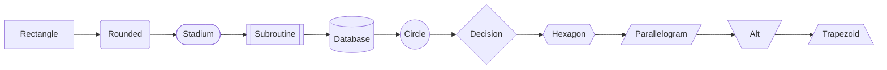

### Every link style

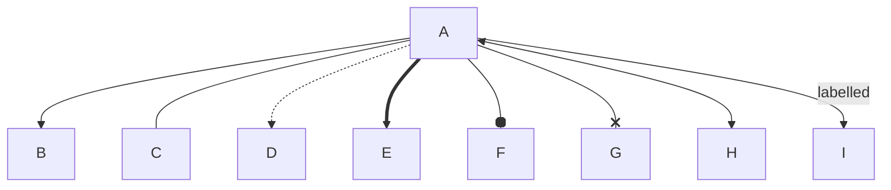

### Decisions and loops

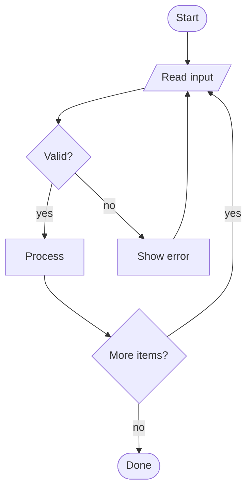

### Subgraphs

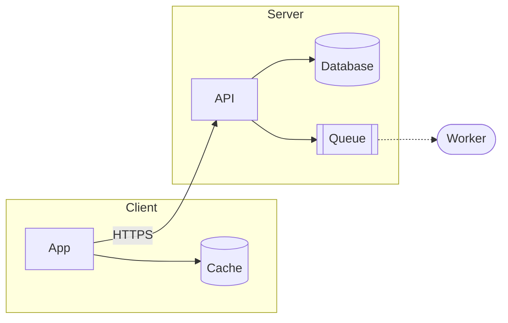

### Nested subgraphs

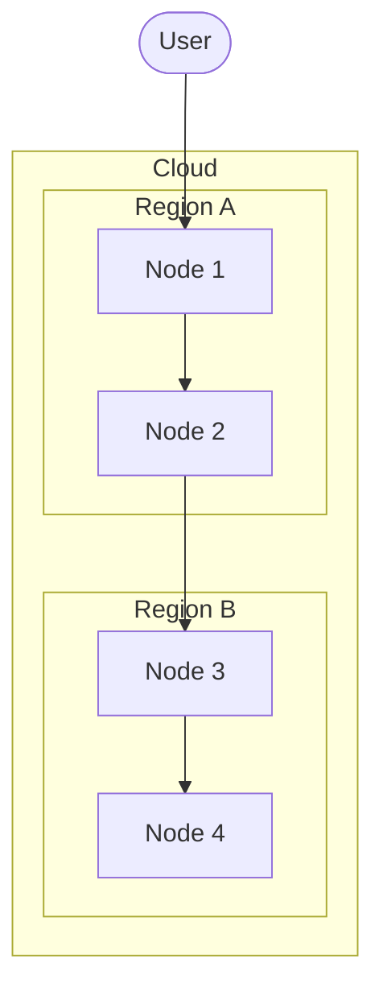

### Fan out and fan in

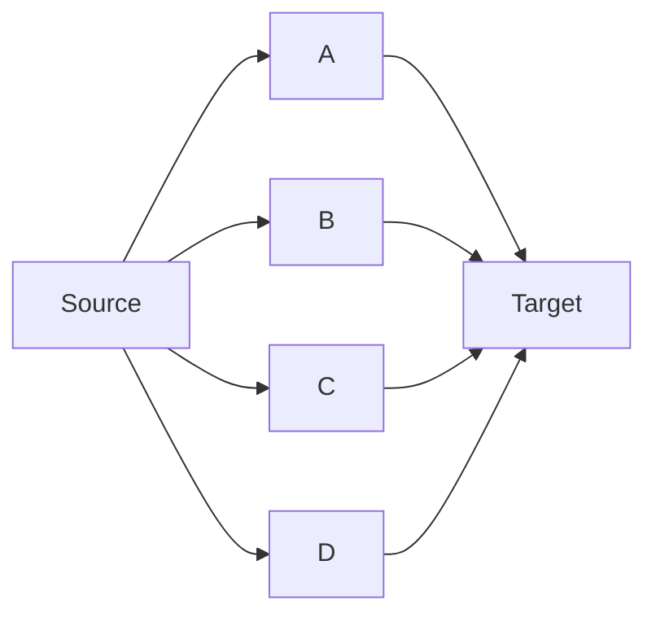

### Bottom up and right to left

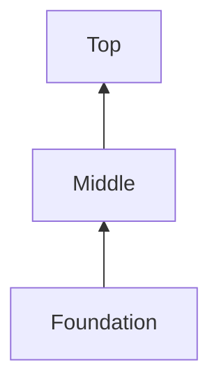

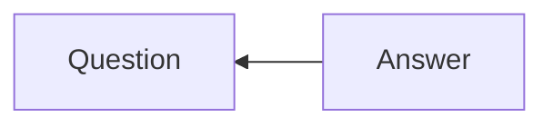

### A node that points at itself

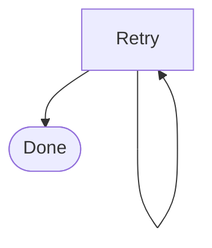

### Long labels

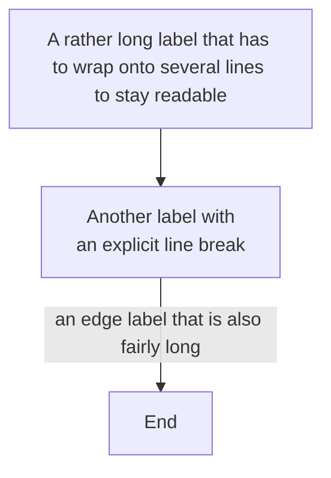

## Sequence diagrams

### A conversation

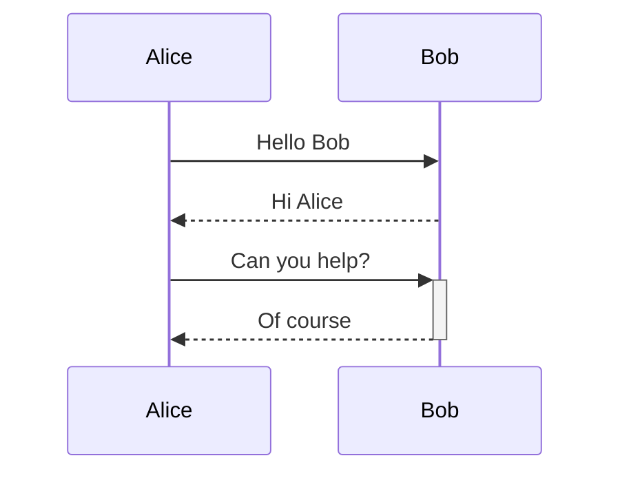

### Activations, notes and self calls

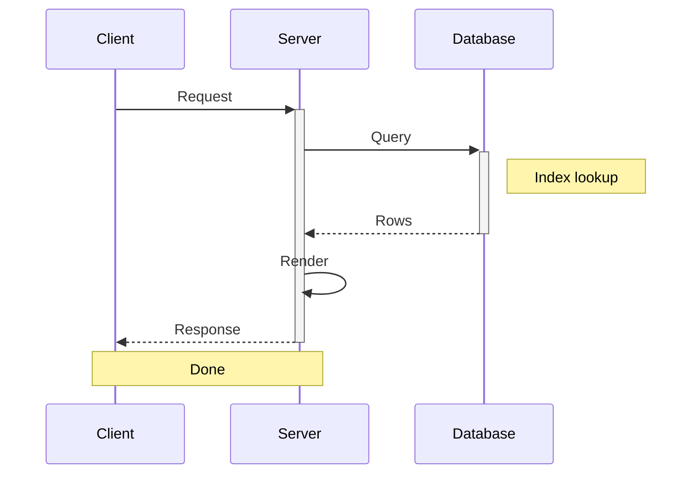

### Blocks

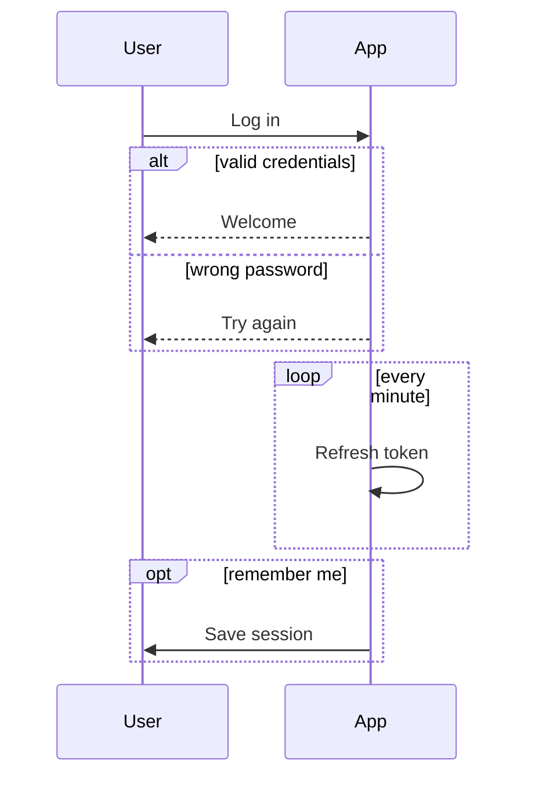

## State diagrams

### A lifecycle

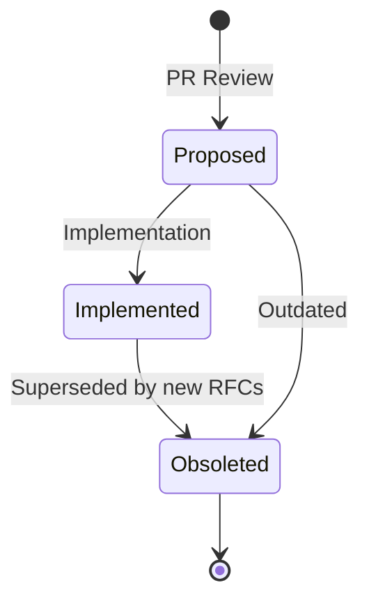

### A machine that loops back

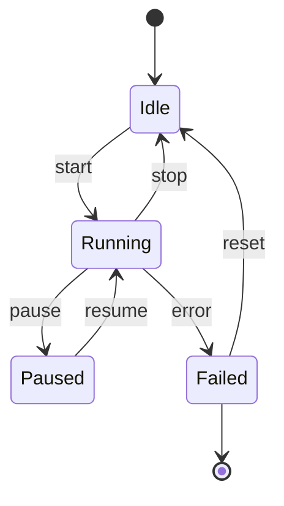

### Composite states

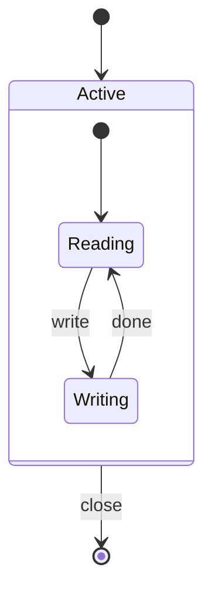

## Class diagrams

### Inheritance

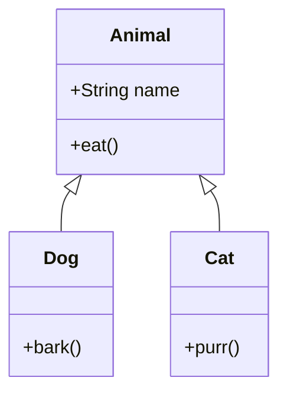

### Relationships

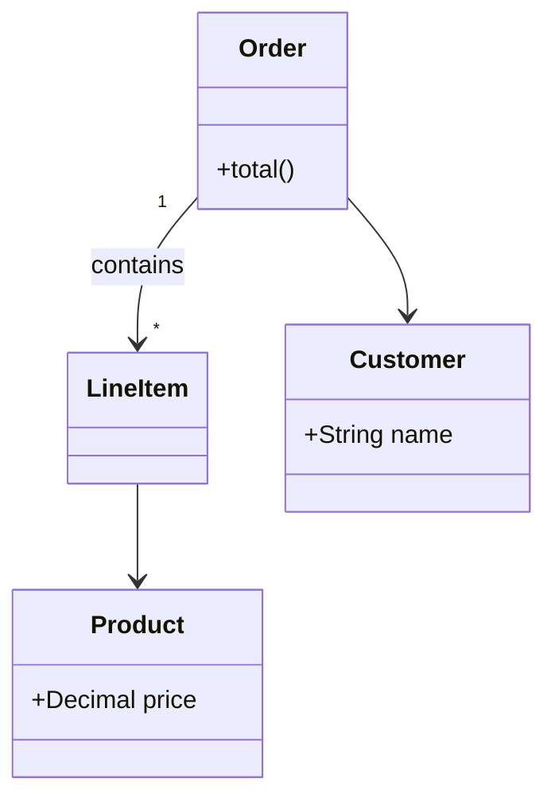

## Entity relationship diagrams

### A shop

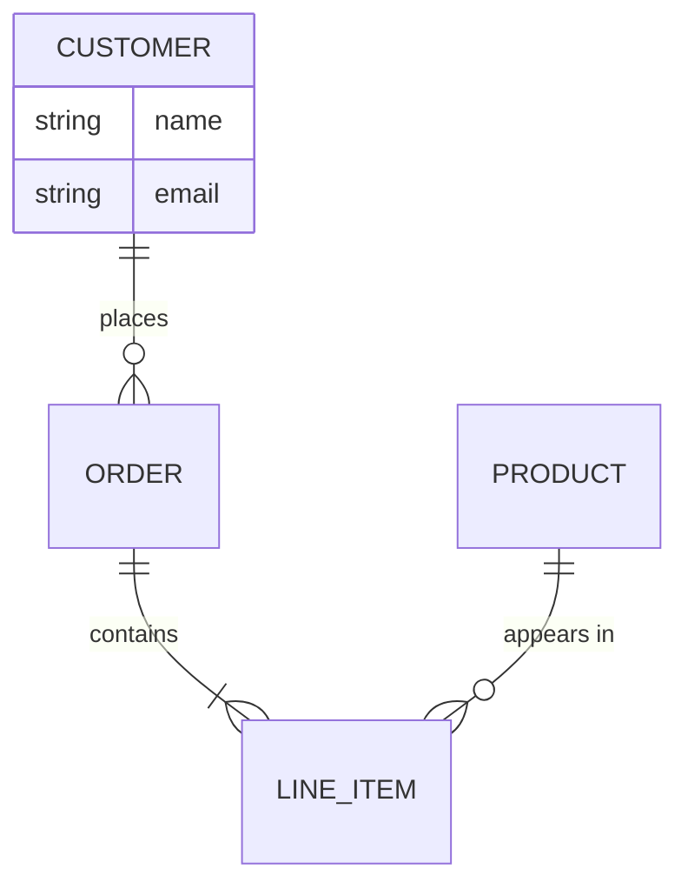

## Pie charts

### Few slices

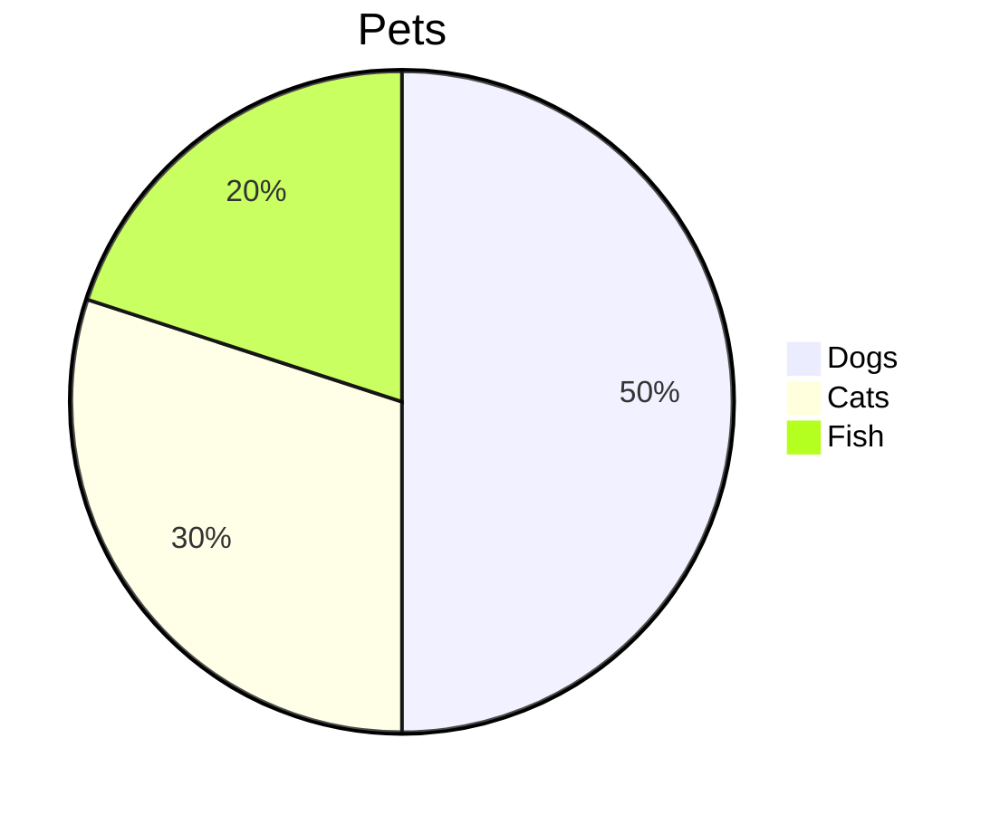

### With values

```mermaid
pie showData title Time spent
  "Reading" : 40
  "Writing" : 25
  "Reviewing" : 15
  "Meetings" : 10
  "Other" : 10
```

### One dominant slice

```mermaid
pie title Coverage
  "Covered" : 92
  "Missed" : 8
```

## Refused or unsupported

These stay as code instead of a broken picture.

```mermaid
gantt
  title Not drawn yet
  section A
  Task : 2026-01-01, 3d
```

```mermaid
this is not a diagram
```
